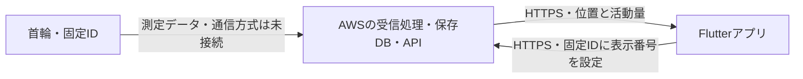

# Cowlogの構成（2026-10-28更新）

利用者と確認したデータ経路は **首輪 → AWS → アプリ**。アプリが首輪から直接データを取得する構成ではない。親機やLoRaを必須にしない。首輪からAWSへ到達する通信方式は、このリポジトリではまだ実装・接続確認できていない。

番号の正本はサーバーの「固定ID → 表示番号」の対応。今回の保存APIはAWS等に配置するサーバー向けの実装であり、首輪本体へ番号を送信・書き込む処理ではない。ファームウェアへの設定送信・受信・保存・受領確認は未実装。

## 実装と未接続の境界

- Flutter: 優先一覧、カラー実地図、履歴、首輪・番号、HTTPS APIクライアント。
- Python API + SQLite: ローカルで動くサーバー参考実装。計測受信、履歴、判定、首輪発見と番号設定。
- AWS: 接続先、受信方式、DBサービス、認証、配置は未設定・未検証。DynamoDB/IoT Core/Lambdaなどを採用済みとは扱わない。
- `firmware/collar`: 既存のGNSS実験とUSB JSON送信モード。AWS直接通信は未実装。
- `firmware/gateway`: 旧USB実験用ツール。今回の運用で親機を必須にする根拠ではない。
- 従来のSwiftUI版は保存しているが、今回の改修対象はFlutter版。

AWS側が同じAPI契約を提供すれば、アプリはHTTPSの接続先を指定して利用できる。AWS上のDBへアプリが直接接続する構成ではない。AWSリソースや首輪の通信が完成したことを意味しない。

詳細は [現行仕様](current-spec.md)、API境界は [データ契約](data-contract.md) を参照。
